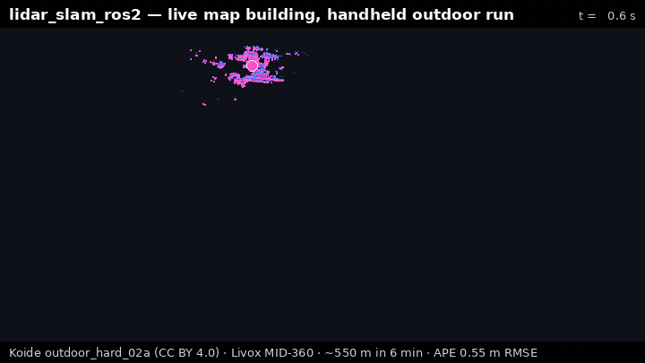
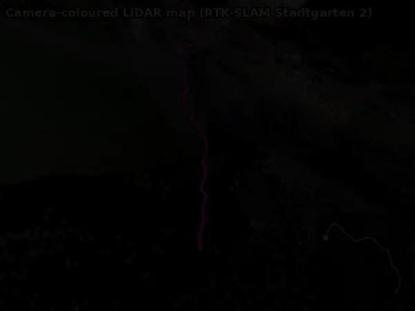
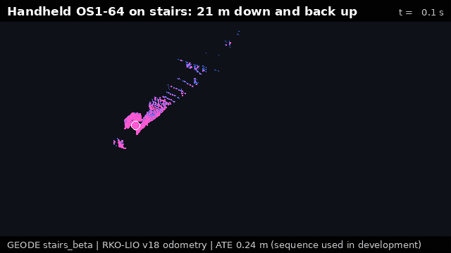
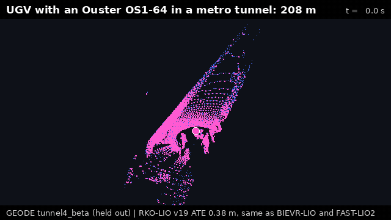
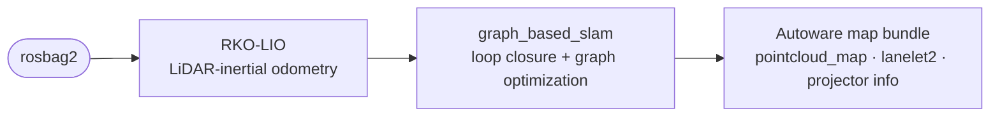

# lidar_slam_ros2

[](https://github.com/rsasaki0109/lidar_slam_ros2/actions/workflows/main.yml)
[](https://opensource.org/licenses/BSD-2-Clause)
[](#support-and-license)
[](https://github.com/rsasaki0109/lidar_slam_ros2/stargazers)

<p align="center">
  
  
  
  
</p>

*Outdoor walk, APE 0.55 m ([Koide](https://zenodo.org/records/10122133), CC BY 4.0) · camera-coloured park ([RTK-SLAM](https://rtk-slam-dataset.github.io/), CC BY 4.0) · stairs, ATE 0.24 m on development data · held-out metro tunnel, 0.38 m like BIEVR-LIO and FAST-LIO2 ([GEODE](https://github.com/PengYu-Team/GEODE_dataset)). [How these were made](docs/readme-media.md).*

**Turn a rosbag into a map you can actually drive on.** ROS 2 LiDAR SLAM that writes an Autoware-compatible map bundle: `pointcloud_map/`, `map_projector_info.yaml` and lanelet2. `RKO-LIO` (MIT) + `graph_based_slam` (BSD-2), no GPL on the default workflow. [日本語クイックスタート](docs/getting-started-ja.md) · release notes [v0.10.0](docs/releases/v0.10.0.md) · next [v0.10.1](docs/releases/v0.10.1.md)

## Quickstart

### Choose your shortest path

| Goal | Start here | Safety and cost boundary |
| --- | --- | --- |
| See a verified map, no build | **Default if unsure:** [Docker demo](#try-it-with-docker-one-command-no-build) | Stable `v0.10.0-humble`; needs Docker; host writes stay in `./lidarslam_output`. |
| Map my own rosbag | [Own-bag route](#map-your-own-bag-one-command-after-install): `lidarslam-map doctor /path/to/rosbag2` | Read-only diagnosis first; then `lidarslam-map start /path/to/rosbag2` writes a new output. |
| Build from source or contribute | [Source quickstart](#build--verified-demo-from-source-one-helper): `bash scripts/source_quickstart.sh --dry-run` | Release `v0.10.0`; needs ROS 2, 8 GiB, and roughly 30 minutes. |

### Try it with Docker (one command, no build)

```bash
docker run --rm -e LIDARSLAM_HOST_UID="$(id -u)" -e LIDARSLAM_HOST_GID="$(id -g)" \
  -v "$PWD/lidarslam_output:/lidarslam_ws/output" \
  ghcr.io/rsasaki0109/lidar_slam_ros2:v0.10.0-humble
```

The 517 MB MID-360 demo writes `lidarslam_output/mid360_demo/` as your user. Other platforms: [Getting Started](docs/getting-started.md).

### Map your own bag (one command after install)

```bash
lidarslam-map start /path/to/rosbag2
```

Run `lidarslam-map` with no arguments for a guided start, or `lidarslam-map doctor` first: it uses no network and writes no files. See [supported inputs](#use-your-own-bag).

### Build + verified demo from source (one helper)

```bash
mkdir -p ~/ros2_ws/src
cd ~/ros2_ws/src
git clone --recursive https://github.com/rsasaki0109/lidar_slam_ros2.git
cd lidar_slam_ros2
bash scripts/source_quickstart.sh
```

The helper detects Humble/Jazzy, installs the dependencies, builds the six maintained packages and runs the verified demo (`--dry-run`, `--build-only`). It prints a `lidarslam-map` path that auto-activates this build. Needs ROS 2, 8 GiB and about 30 minutes. Before handoff: `python3 scripts/check_first_map_verification_package.py --json`, continue only on `READY`.

## Use your own bag

For an Ouster, Velodyne, RoboSense or other PointCloud2 bag, do not edit this package's launch files or YAML first: run `lidarslam-map doctor`, then `lidarslam-map start`. It checks topics, frames, fields, timestamps, a maintained profile and calibration, and stops unsafe inputs with a stable reason code and one next action. Maintained inputs: PointCloud2+Imu, PointCloud2+NavSatFix, VelodyneScan+Applanix GSOF49.

- **Docker, no ROS:** `bash scripts/docker_map_bag.sh /absolute/path/to/rosbag2` mounts the bag read-only ([Docker Own-Bag Map](docs/getting-started.md#docker-own-bag-map)).
- **After a run:** `lidarslam-map view`, `lidarslam-map sessions`, `lidarslam-map compare day1 day2`, `lidarslam-map support day1`, `lidarslam-map merge day1 day2 --output-dir site_project`.
- **Report on a fixed output:** `lidarslam-map report /path/to/output/mid360_demo --json` ([first-map validation guide](docs/external-first-map-validation.md)).
- **Automation:** `lidarslam-map run` ([Operator workflows](docs/workflows.md)). Localization: [Localize On The Map](docs/getting-started.md#5-localize-on-the-map).

## Why lidarslam_ros2

- **Autoware-compatible output:** `verify_autoware_map.py` prints `map_verify: PASS` on every saved bundle.
- **lanelet2 auto-generation** from the SLAM trajectory, validated for Autoware routing.
- **Surveyed ground truth:** per-dataset APE thresholds gate every release in CI ([accuracy](#accuracy)).
- **Loop closure, GPL-free:** Scan Context, BEV / SOLiD / Triangle descriptors and 3D-BBS verification (opt-in).
- **Tunnels and fog:** radar fusion maps a ~500 m tunnel; without radar, an Ouster preset holds all ten ENWIDE sequences; on GEODE's 13 held-out tunnel bags, no failure but not the most accurate ([comparison](docs/comparison.md#degenerate-lidar-imu-odometry-on-enwide), [guide](docs/degeneracy-guide.md)).
- **Deterministic offline mapping:** byte-identical trajectories, loop edges and submaps.
- **Refined maps:** plane bundle adjustment under holdout-validated thresholds ([evidence](docs/research/map-quality-baseline.md)).



## Camera-coloured point-cloud maps

The pipeline refines each camera pose against the LiDAR map, then projects the pixels onto it. On the park walk at the top (RTK-SLAM Stadtgarten 2; [MP4](lidarslam/images/map_flythrough_stadtgarten.mp4) · [GIF](lidarslam/images/map_flythrough_stadtgarten.gif)) the refinement cuts the held-out epipolar error from 4.02 to 0.67 px ([tool](tools/colored_map/README.md), [release reference](docs/research/colored-map-release-readiness-2026-07.md)).

```bash
python3 tools/colored_map/colored_map_pipeline.py \
  <bag> output/<run>/traj_corrected.tum output/<run>/colored_map \
  --raw-traj output/<run>/traj_raw.tum \
  --extrinsic configs/gaussian_splatting/<lidar_camera_extrinsic>.yaml
```

Moving rigs: `--refine-spatiotemporal-calibration` ([design](docs/research/colored-map-spatiotemporal-calibration-2026-07.md)). Regression gates: [Benchmarking](docs/benchmarking.md#slam-candidate-regression).

## Open-source benchmark results

On the same HILTI 2022 `exp04` LiDAR/IMU input and CPU-only host, the competitive
profile recorded **34.7% lower median APE RMSE than GLIM** over three runs:

| System | Median APE RMSE | Median processing RTF | Maximum peak RSS |
| --- | ---: | ---: | ---: |
| **lidarslam_ros2** | **0.0565 m** | 0.993 | **586.83 MB** |
| GLIM CPU | 0.0866 m | **0.244** | 690.88 MB |

This is a scoped HILTI `exp04` trajectory-accuracy and peak-memory win; GLIM wins runtime. It is not an overall best-system claim. Commands, scoring rules and map-quality limits: [Comparison](docs/comparison.md#same-input-hilti-2022-exp04-vs-glim-cpu).

The separate Voxel-SLAM `v17` research candidate also achieved the lowest
geometric-mean APE across NavINST, Oxford, and UrbanNav: **2.2836 m**, versus
GLIM `5.0779`, Point-LIO `3.8388`, FAST-LIO2 `6.9576`, and fixed Voxel-SLAM
`2.7160` — **55.0% lower than GLIM**. It is not the default release path, does
not win every sequence, and is not fresh-blind evidence. Exact revisions,
per-sequence results, input hashes, resource results, map limitations, and
reproduction notes are in [Comparison](docs/comparison.md#voxel-slam-v17-research-candidate-vs-pinned-oss-rivals).

Development-data results with loop closure on the MapsHD humanoid MID-360
trials, Oxford Spires Keble 05 and HILTI `exp04`, with settings chosen on those
same sequences, are in
[Comparison](docs/comparison.md#development-data-results-mapshd-humanoid-trials-oxford-spires-and-exp04).

<!-- BEGIN GENERATED COMPETITIVE CLAIM PUBLICATION -->
<!-- END GENERATED COMPETITIVE CLAIM PUBLICATION -->

## Accuracy

Release-gate thresholds ([Benchmarking](docs/benchmarking.md#release-gate-accuracy-snapshot)) block every release in CI. Tunnel and fog mapping: [Degeneracy Resilience Guide](docs/degeneracy-guide.md).

## Docs

- **Getting started**: [Getting Started](docs/getting-started.md) · [Distribution](docs/distribution.md) · [Autoware quickstart](docs/autoware-quickstart.md) · [Operator workflows](docs/workflows.md) · [Autoware Foxglove](docs/autoware-foxglove.md)
- **Pipelines**: [Autoware-compatible map authoring](docs/autoware-map-authoring.md)
- **Benchmarking**: [Benchmarking and release gate](docs/benchmarking.md) · [Comparison](docs/comparison.md)
- **Project**: [Product contract](docs/product-contract.md) · [v1.0 readiness](docs/v1-readiness.md) · [Independent first-map validation](docs/external-first-map-validation.md) · [v0.10.0 notes](docs/releases/v0.10.0.md) · [v0.10.1 candidate](docs/releases/v0.10.1.md) · [v0.9 roadmap](docs/roadmap/v0.9.md) · [Contributing](CONTRIBUTING.md) · [Support](SUPPORT.md) · [Security](SECURITY.md) · [Governance](GOVERNANCE.md) · [Changelog](CHANGELOG.md) · [Releasing](RELEASING.md)

Preview the doc site locally: `python3 -m mkdocs serve`.

## Support and license

| ROS 2 distro | Ubuntu | Scope |
| --- | --- | --- |
| Humble | 22.04 | default workflow build + package tests in CI |
| Jazzy  | 24.04 | default workflow build + package tests in CI; Autoware dogfood exercised locally |

`graph_based_slam` is BSD-2-Clause; `RKO-LIO`, `DLIO`, and the optional vendored
`3D-BBS` are MIT; `FAST_GICP` is BSD-3-Clause; built-in Scan Context is local. GPL-only
components (`Thirdparty/lio-sam`, `Thirdparty/3d_bbs`) are excluded via `COLCON_IGNORE`.

## Quality gates

```bash
bash scripts/run_default_ci_checks.sh
```
Full gate list and parameter pointers: [docs/workflows.md](docs/workflows.md).

If this project saves you mapping time, a ⭐ helps others find it.
